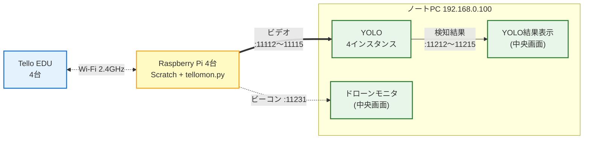

# kids-drone-system

子供向け体験イベント **「おもしろ体験でぇ～」**（2026/7/24-25 開催）の出展システム。

子供が Scratch で Tello ドローンを操作し、ドローンの空撮映像を YOLO で犬猫検知 → 中央モニタに位置と検知結果をリアルタイム表示する。

## システム構成

- **同時稼働 4 台**（Tello EDU / Raspberry Pi 各4台、YOLO PC 1台、中央ノートPC 1台）
- 操作 UI は Scratch のみ（子供が触る唯一の UI）
- 中央モニタは「全機俯瞰」用、個別 UI は作らない

詳細は [docs/figures/system-arch.mmd](docs/figures/system-arch.mmd) と運用配置図 [docs/figures/operation-layout.mmd](docs/figures/operation-layout.mmd) 参照。

## ディレクトリ構成

| ディレクトリ | 役割 |
|---|---|
| `pi/tellomon/` | Pi 側の Tello 制御プログラム（映像転送・ビーコン送信・HTTP API）|
| `yolo_pc/yolo_proc/` | YOLO PC 側の推論プロセス（YOLOv8）|
| `operator_pc/drone_monitor/` | 中央ノートPC のドローンモニタ |
| `operator_pc/yolo_display/` | 中央ノートPC の YOLO 結果表示 |
| `shared/` | ポート番号・JSON フォーマット等の共通定義 |
| `Scratch/` | 子供向け UI（LLK 公式 clone + drone 拡張 / **git 管理外**）|
| `docs/` | 設計書・計画書 |

> `Scratch/` は LLK 公式リポジトリの clone のため `.gitignore` で除外しています。改修要否は 6/30 時点で判断し、必要なら部 org に fork して submodule 化します。

## ライセンス

[MIT](LICENSE)
